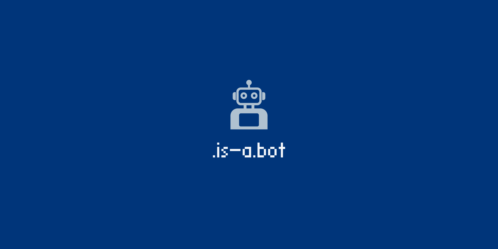

   

   
   
   
    

<h1 align="center">🤖 is-a.bot</h1>

<strong>is-a.bot</strong> is a service that allows developers to get a sweet-looking <code>.is-a.bot</code> subdomain for their robot's website.

📕 <a href="https://docs.is-a.dev">Documentation</a> &bull; 📜 <a href="https://is-a.bot/terms">Terms of Service</a> &bull; 💖 <a href="https://donate.is-a.bot">Donate</a>

---

## 📢 Announcements
Please join our [Discord server](https://discord.gg/is-a-dev-830872854677422150) for announcements, service updates, and downtime notifications regarding the service.

Only critical announcements are posted on GitHub, everything else is posted on our Discord server.

---

# ✏️ Register
> [!NOTE]
> Our registration process is the same as the [`is-a.dev`](https://github.com/is-a-dev/register) service, however it is using this repository instead.

- [Fork](https://github.com/free-domains/is-a.bot/fork) the repository.
- Follow the instructions on our [documentation](https://docs.is-a.dev).
- Once you open your pull request (PR), it will be reviewed. *Keep an eye on it in case changes are needed!*
   - If changes have been requested, please make the specified changes otherwise **you will be rejected**.
- Once your PR is merged, your DNS records should be published with-in a few minutes.
- Enjoy your new `.is-a.bot` subdomain! Please consider leaving a star ⭐️ to help support us!

> We are aware of some issues where users cannot properly verify their subdomain with Vercel, we are sorting this out ASAP.

## ⛔ Report Abuse
If you find any subdomains being abused or breaking our [ToS](https://is-a.dev/terms), please report them by [creating an issue](https://github.com/free-domains/is-a.bot/issues/new?title=Report+abuse) with relevant evidence.

## 💖 Supporting Us
If you would like to help support us, please consider [donating](https://donate.is-a.dev) or [sponsoring](https://donate.is-a.dev/sponsor).

We are proudly supported by Cloudflare's [Project Alexandria](https://www.cloudflare.com/lp/project-alexandria) program for our DNS management.

---

###### :star: Owned & operated by the maintainers of [is-a.dev](https://github.com/is-a-dev/register).

